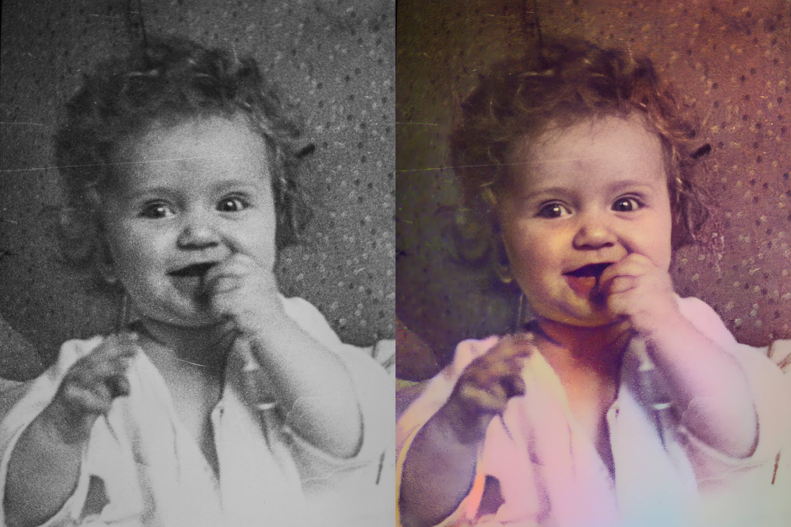
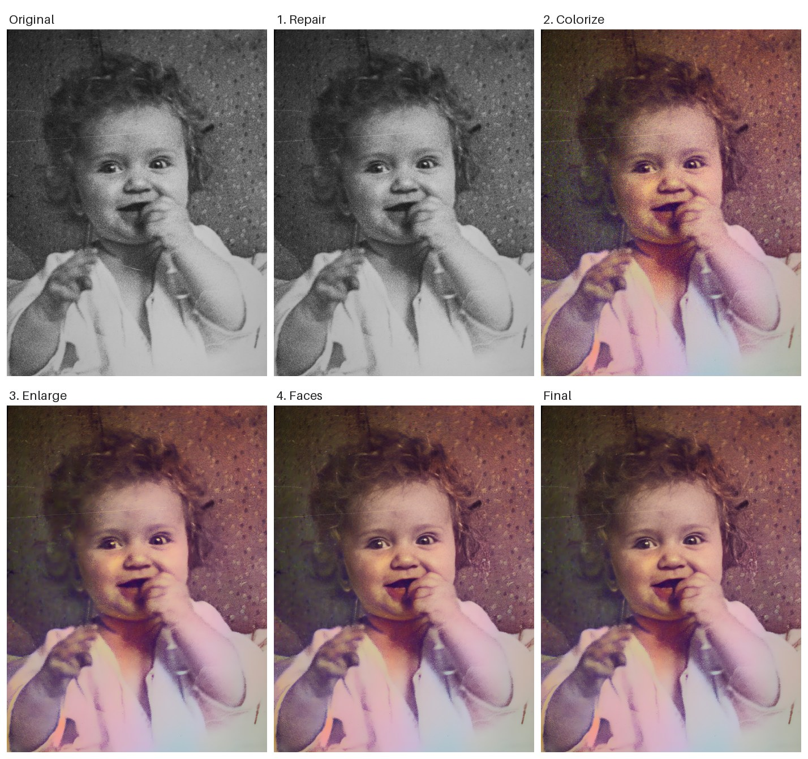
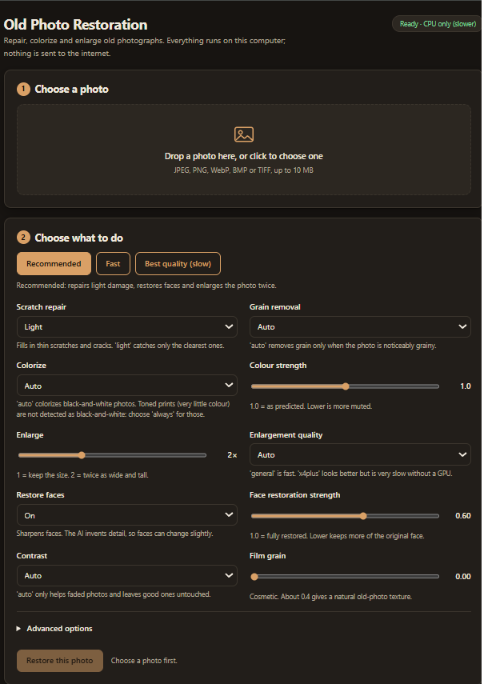
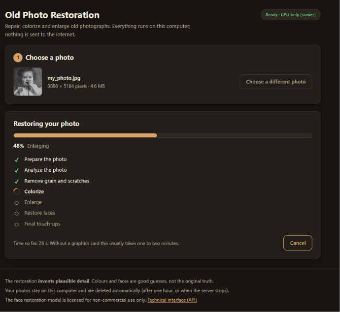
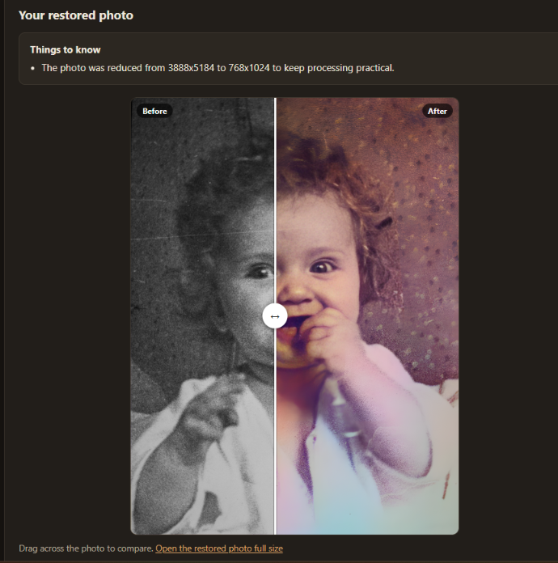
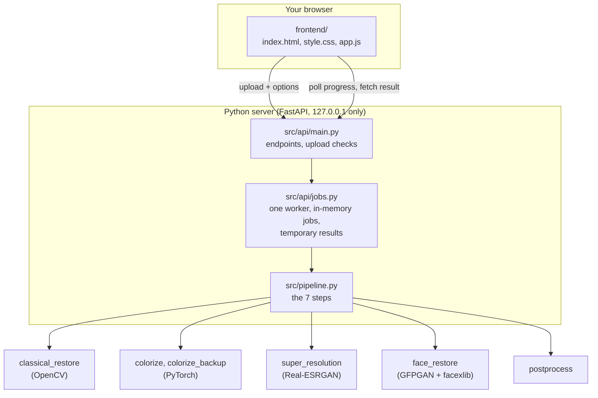
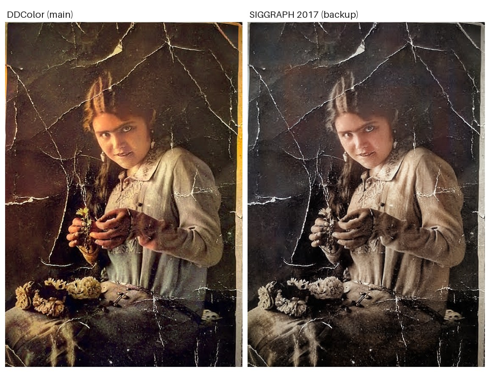
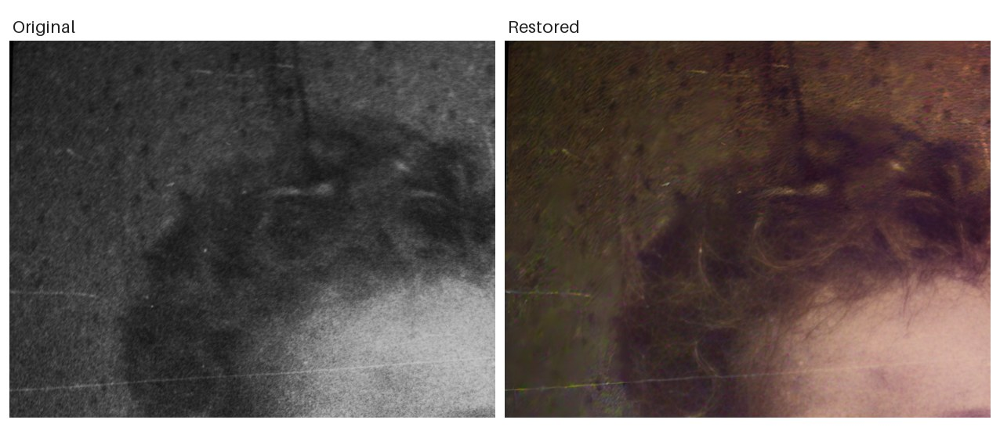

# AI Old Photo Restoration & Colorization


**Restore old photographs on your own computer.** A web app and command-line tool that takes a scanned old photo through a chain of open-source models: it repairs thin scratches and folds, colorizes black-and-white photos, restores faces, enlarges the picture and applies light finishing touches.

Everything runs locally, on a CPU if you have no graphics card. There are **no paid services, no cloud APIs and no Hugging Face dependency**: every model comes from its authors' official GitHub repository or project host.

<!-- ADD IMAGE 1 of 8 (hero): save as docs/images/hero-before-after.jpg
     Content: ONE good before | after pair, side by side. Use a photo you have the rights to share.
     How to make it: see "Images to add" in the notes that came with this README. -->
<p align="center">
  
</p>
<p align="center"><em>TODO: caption, for example "Left: original scan. Right: restored with the default settings. Photo: (source or credit)."</em></p>

> **Status: working, with modest results.** The full pipeline and the web app work end to end (tested on Windows, CPU only). On the photos tried so far, the clearest gains are **the removal of some of the larger folds and cracks** and **sharper faces**. Colour is a plausible guess that can differ between runs, fine cracks and heavy damage remain, and enlarging also sharpens the damage. This is a learning project about integrating several pretrained models into one reliable local application. It is not a replacement for professional restoration. See [Known limitations](#14-known-limitations).

## Contents

1. [What it does](#1-what-it-does)
2. [Results](#2-results)
3. [Features](#3-features)
4. [Quick start](#4-quick-start)
5. [Using it](#5-using-it)
6. [How it works](#6-how-it-works)
7. [Performance](#7-performance)
8. [Models and licenses](#8-models-and-licenses)
9. [Engineering notes](#9-engineering-notes)
10. [Testing](#10-testing)
11. [Project structure](#11-project-structure)
12. [Configuration](#12-configuration)
13. [Privacy and security](#13-privacy-and-security)
14. [Known limitations](#14-known-limitations)
15. [Troubleshooting](#15-troubleshooting)
16. [Roadmap](#16-roadmap)
17. [Credits](#17-credits)
18. [License](#18-license)

---

## 1. What it does

A photo goes through seven steps. Each can be switched off or tuned.

| Step | What happens | Built with |
|---|---|---|
| **prepare** | Shrinks very large photos to a working size. Never enlarges. | Pillow |
| **analyze** | Measures colour type, noise, contrast and sharpness. | OpenCV, NumPy |
| **repair** | Removes grain and fills thin scratches and cracks. | OpenCV (non-local means, morphology, inpainting) |
| **colorize** | Adds colour to black-and-white photos. | DDColor; a smaller backup model (Zhang et al., SIGGRAPH 2017) takes over if it fails |
| **upscale** | Enlarges the photo up to 4 times. | Real-ESRGAN |
| **faces** | Restores faces and pastes them onto the enlarged photo. | GFPGAN v1.4, facexlib |
| **finish** | Restores contrast on faded photos. Optional film grain. | OpenCV |


## 2. Results

<!-- ADD IMAGE 2 of 8: save as docs/images/pipeline-steps.jpg
     Content: a 3 x 2 grid of the SAME photo after each step: Original, 1. Repair, 2. Colorize, 3. Enlarge, 4. Faces, Final. -->
<p align="center">
  
</p>
<p align="center"><em>TODO: caption, for example "The same photo after each step (settings: ...)."</em></p>

**What to expect, in plain words:**

| Works reasonably well | Does not work, or only partly |
|---|---|
| Removes some of the **larger folds and cracks** (the clearest, highest-contrast ones) | **Fine, branching cracks, stains, tears and missing areas** remain. Filled areas can look smooth and slightly "melted". |
| **Faces become sharper and cleaner** (GFPGAN) | The AI **invents detail**: faces can change slightly, for example eye colour at full strength |
| Black-and-white photos get **plausible colour** | Colour is a **guess**, and it can change noticeably between runs on slightly different input |
| Faded photos get their contrast back (tested on an artificially faded copy) | Enlarging **sharpens the damage too**. The fast enlarging model also gives an "airbrushed" look. |

**How this was evaluated:** informally, by looking at results. Development concentrated on one heavily cracked portrait, plus synthetic tests for individual steps. There are **no quantitative benchmarks** (no PSNR/SSIM numbers) and no large test set yet. TODO: update this paragraph if you test more photos.

## 3. Features

**Web app**
- Drag-and-drop upload with preview and instant checks (type, size)
- Options built from the server's own list, plus three quick settings (Recommended, Fast, Best quality)
- Live progress with a step list, elapsed time and Cancel
- Before/after slider (mouse and keyboard), PNG and JPEG downloads
- Light and dark theme, a layout that adapts to phone widths (checked at phone sizes, not on a real phone), keyboard accessible, no external fonts or scripts

**Pipeline**
- Every step is optional and has its own settings
- A step that fails (for example a missing model file) does not stop the run: the photo continues without it and the failure is reported
- Automatic fallback to a smaller colorizer, automatic retry on the CPU if the GPU runs out of memory, tiled enlarging to limit memory use

**Reliability and safety**
- Uploads are validated by content, not by file name (type, size, pixel count, corruption)
- Downloaded model files are verified with SHA-256 checksums where one is known
- Photos stay on your computer and results are deleted automatically
- Every module ships a self-test that needs no model files

## 4. Quick start

**Requirements**

| | Minimum | Recommended |
|---|---|---|
| OS | Windows 10/11 (the only system tested) | Windows 11 |
| Python | **3.11** (newer versions can fail to install the pinned packages) | 3.11 |
| CPU | 4 cores | 6 or more cores |
| RAM | 8 GB | 16 GB |
| GPU | none (CPU works) | NVIDIA with 6 GB or more (code path implemented but **untested on real GPU hardware**) |
| Free disk | 10 GB | 15 GB |

Model downloads total about 1.7 GB. Loading DDColor needs roughly 2 to 3 GB of RAM at its peak. You also need Git.

Run in **Windows PowerShell**:

```powershell
# 1. Get the code (replace YOUR-USERNAME)
git clone https://github.com/YOUR-USERNAME/photo-restorer.git
cd photo-restorer

# 2. Create and activate a virtual environment
py -3.11 -m venv .venv
.venv\Scripts\Activate.ps1
python -m pip install --upgrade pip

# 3. Install PyTorch FIRST (pick ONE)
#    CPU only:
pip install torch==2.1.2 torchvision==0.16.2 --index-url https://download.pytorch.org/whl/cpu
#    NVIDIA GPU:
pip install torch==2.1.2 torchvision==0.16.2 --index-url https://download.pytorch.org/whl/cu121

# 4. Install the other packages, then check the environment
pip install -r requirements.txt
python scripts\check_environment.py

# 5. Fetch model CODE that is not stored in this repository
python scripts\setup_face_code.py

# 6. Download and verify the model WEIGHTS (about 1.7 GB, can take a while)
python scripts\download_weights.py
python scripts\download_weights.py --verify

# 7. Start the website
python -m src.api.main
```

Then open **http://127.0.0.1:8000** in your browser. The first start can take 10 to 40 seconds while PyTorch loads.

Notes:
- If PowerShell says scripts are disabled: `Set-ExecutionPolicy -Scope Process -ExecutionPolicy RemoteSigned`, then activate again.
- Step 5 is needed because GFPGAN's code is deliberately **not committed** (see [Models and licenses](#8-models-and-licenses)). The other model code lives in `src/vendor/`. If one of those folders is missing, run the matching script: `setup_ddcolor_code.py`, `setup_upscaler_code.py` or `setup_backup_colorizer.py --skip-weights`.
- If the DDColor download from ModelScope is slow or fails, the script prints manual browser steps.
- A GPU warning on a computer without an NVIDIA GPU is expected. Only `FAIL` lines matter.

## 5. Using it

### 5.1 The website

1. Drop a photo on the page (or click to choose one).
2. Pick a quick setting, or adjust the options.
3. Press **Restore this photo** and watch the progress.
4. Drag across the result to compare, then download it.

For toned prints (a nearly colourless photo with warm or cool tints), choose **Colorize: Always**. The automatic detection only recognises plain black-and-white and single-tint photos.

<!-- ADD IMAGES 3, 4, 5 of 8: save as docs/images/web-ui-options.png, web-ui-progress.png, web-ui-result.png
     Content: three screenshots of the real website, desktop width about 1100 px. -->

| Choose a photo and options | Progress | Result with before/after slider |
|---|---|---|
|  |  |  |

### 5.2 The command line

```powershell
python -m src.pipeline samples\my_photo.jpg
python -m src.pipeline samples\my_photo.jpg --colorize always --upscale 2 --keep-steps
```

Results go to `outputs\`: `restored_my_photo.png` and `restored_my_photo_comparison.png` (before on the left, after on the right). `--keep-steps` also saves the photo after each step.

| Option | Values (default first) | Meaning |
|---|---|---|
| `--repair` | `light`, `off`, `strong` | Scratch repair strength |
| `--denoise` | `auto`, `off` | Grain removal (only when grain is detected) |
| `--colorize` | `auto`, `always`, `never` | Whether to add colour |
| `--saturation` | `1.0` (0.0 to 2.0) | Colour strength |
| `--upscale` | `2` (1 = off, up to 4) | Enlargement factor |
| `--upscale-model` | `auto`, `general`, `x4plus` | `general` is fast. `x4plus` looks better but is very slow on a CPU. |
| `--faces` | `on`, `off` | Face restoration |
| `--face-strength` | `0.6` (0.0 to 1.0) | 1.0 = fully restored faces, 0.0 = the original |
| `--contrast` | `auto`, `on`, `off` | Contrast restoration (`auto` only touches faded photos) |
| `--grain` | `0.0` (0.0 to 1.0) | Cosmetic film grain. About 0.4 resembles typical old-photo grain. |
| `--keep-steps` | flag | Save each intermediate picture |

The `medium` repair level is deliberately not offered: on the test photo it hit the safety cap and silently repaired nothing.

### 5.3 Single stages

Each stage can run alone, which is useful for seeing what it does:

| Command | What it does |
|---|---|
| `python -m src.image_io FILE` | Load and validate, print the file's details |
| `python -m src.analysis FILE` | Colour type, noise, sharpness, contrast, face hint |
| `python -m src.classical_restore FILE` | Grain and scratch repair, with a mask of repaired pixels |
| `python -m src.colorize FILE` | DDColor |
| `python -m src.colorize_backup FILE [--chain]` | Backup colorizer, or DDColor with automatic fallback |
| `python -m src.face_restore FILE [--strength X]` | GFPGAN faces |
| `python -m src.super_resolution FILE [--scale X] [--model M]` | Real-ESRGAN |
| `python -m src.postprocess FILE [--grain X] [--simulate-fade]` | Contrast and grain |

### 5.4 The API

The website is a thin layer over a small HTTP API. An interactive page is at `http://127.0.0.1:8000/docs` (it loads its interface from a public CDN, so it needs an internet connection).

| Method and path | Purpose |
|---|---|
| `GET /api/health` | Server status, device, which models are installed |
| `GET /api/options` | Every option with allowed values and defaults, plus the pipeline steps |
| `POST /api/jobs` | Upload a photo and options, returns a job id |
| `GET /api/jobs/{id}` | Status, progress, step table, notes |
| `POST /api/jobs/{id}/cancel` | Cancel a job (takes effect between steps) |
| `DELETE /api/jobs/{id}` | Delete a finished job and its pictures |
| `GET /api/jobs/{id}/result` | The restored picture (`?format=png\|jpeg`, `?download=1`) |
| `GET /api/jobs/{id}/original` | The "before" picture at working size |

```powershell
curl.exe -F "file=@samples\my_photo.jpg" -F "upscale=2" http://127.0.0.1:8000/api/jobs
curl.exe http://127.0.0.1:8000/api/jobs/JOB_ID
curl.exe -o restored.png http://127.0.0.1:8000/api/jobs/JOB_ID/result
```

## 6. How it works



The command line and the web app share the same pipeline, so they behave the same. The server runs **one job at a time** (the models are heavy) and keeps jobs in memory: no database, no Redis, no Docker.

### Decisions backed by measurement

These come from side-by-side tests on **one** heavily cracked portrait. Treat them as development observations, not general findings.

| Question | What was observed | Decision |
|---|---|---|
| Restore faces before or after enlarging? | Faces first, then the fast enlarger: a glowing eye and plastic skin. Enlarging first, then pasting the 512-pixel restored face onto the enlarged photo: natural skin. | **Enlarge first, then paste faces** |
| Which enlarging model by default? | The pasted face is identical with either model. The best model only improves clothing and hands, at about 15 to 20 times the compute on a CPU. | **Fast model by default**, best model optional |
| Which repair level by default? | `low` removed the most prominent cracks and never touched the face. `medium` hit the safety cap and repaired nothing. | **"light" = low, "strong" = high**, no medium |
| Face restoration strength | At 1.0 one eye got an invented different colour. At 0.6 both eyes were consistent and it still looked like the same person. | **Default 0.6** |
| Post-processing | Contrast was already fine at every stage. Enlarging removed most grain (estimated grain level 4.8 down to 0.6 to 0.9). | Contrast fix only for faded photos. Grain is optional and off by default. |

<!-- ADD IMAGE 6 of 8 (optional): save as docs/images/colorizers-compare.jpg
     Content: the SAME grayscale photo colorized by DDColor (left) and by the backup model (right). -->
<!-- ADD IMAGE 7 of 8 (optional): save as docs/images/face-strength.jpg
     Content: a face crop at three settings: Original, strength 0.6, strength 1.0. -->
<p align="center">
  
</p>
<p align="center"><em>TODO: caption, for example "Left: DDColor (main) and the smaller backup model, whose colours are about half as vivid on this photo. Right: face restoration at three strengths."</em></p>

## 7. Performance

Measured per stage on a 459 x 668 photo, **CPU only**. Machine: TODO: CPU model, RAM, Windows version.

| Stage | Time | Note |
|---|---|---|
| DDColor: load (once per process) | 12 to 16 s | first colorization after starting |
| DDColor: colorize | 9.5 to 10.7 s | |
| Backup colorizer: load, colorize | 0.3 s, 1.3 s | |
| Face models: load (once per process) | 2.6 to 3.8 s | |
| Face restoration | 8.3 to 9.7 s | per face |
| Enlarging 2x, fast model | 9.2 to 9.6 s | output 918 x 1336 |
| **Whole pipeline, no colorizing** | **28 s** | includes loading the face and enlarging models |
| **Whole pipeline, with colorizing** | **56 s** | includes 16 s of DDColor loading |

A second photo in the same session skips the model loading. The best enlarging model (`x4plus`) takes minutes on a CPU. The GPU path is implemented but untested.

## 8. Models and licenses

| Component | Role | Code license | Notes |
|---|---|---|---|
| [DDColor](https://github.com/piddnad/DDColor) (ICCV 2023) | Main colorizer | Apache 2.0 | Weights hosted by the authors on ModelScope. The weights' own license was **not independently verified**. No checksum is known for this file. |
| [Colorization, Zhang et al.](https://github.com/richzhang/colorization) (SIGGRAPH 2017) | Backup colorizer | BSD 2-Clause | Weights trained on ImageNet, hosted by the authors on S3, pinned by full SHA-256 |
| [GFPGAN](https://github.com/TencentARC/GFPGAN) v1.4 | Face restoration | Apache 2.0 headline, **with third-party exceptions** | Its LICENSE lists StyleGAN2-derived code under NVIDIA's license (research or evaluation use only) and DFDNet-derived code under CC BY-NC-SA 4.0. **Treat GFPGAN and its weights as non-commercial.** Its code is deliberately not committed here. |
| [facexlib](https://github.com/xinntao/facexlib) | Face detection and alignment | MIT | A small subset is included |
| [Real-ESRGAN](https://github.com/xinntao/Real-ESRGAN) | Enlarging | BSD 3-Clause | `RRDBNet` comes from BasicSR (Apache 2.0) |
| OpenCV, Pillow, NumPy, PyTorch, FastAPI | Libraries | their own open-source licenses | |

Because one component is non-commercial, treat the whole combination as **for personal, educational and research use** unless you obtain legal advice.

**Downloaded files** (sizes approximate):

| File | Size | Source | Integrity check |
|---|---|---|---|
| `ddcolor/pytorch_model.pt` | 910 MB | ModelScope (DDColor authors) | loader verifies it fits the model; no checksum known |
| `colorizer_backup/siggraph17-df00044c.pth` | 137 MB | authors' S3 bucket | SHA-256 |
| `gfpgan/GFPGANv1.4.pth` | 350 MB | GitHub release | SHA-256 |
| `facexlib/detection_Resnet50_Final.pth`, `parsing_parsenet.pth` | 110 MB, 85 MB | GitHub release | SHA-256 |
| `realesrgan/RealESRGAN_x4plus.pth`, `realesr-general-x4v3.pth` | 67 MB, 5 MB | GitHub release | SHA-256 |

No model comes from Hugging Face. Weights are not stored in Git.

## 9. Engineering notes

Decisions that shaped the code, and the reasons:

- **No `basicsr` install.** It is hard to install and import on many setups. Only the network definitions that are needed are copied from the official repositories, pinned to a commit and checked against SHA-256 checksums, by the `scripts/setup_*.py` scripts. Small stand-ins replace the two or three helper functions they import.
- **Checkpoints are verified, not trusted.** DDColor's own loader uses `strict=False`, which would silently give garbage colours from a mismatched file. Ours raises a clear error. Weights load in PyTorch's `weights_only` mode where possible.
- **Upstream pitfalls avoided.** Real-ESRGAN's tiling leaves a black square when a tile fails (ours raises an error). GFPGAN v1.4's `weight` option has no effect (verified: identical output), so a real blend is implemented instead. Model output slightly outside 0 to 1 is clipped before conversion to bytes, because otherwise bright pixels wrap around to dark.
- **Tile padding was measured, not copied.** Real-ESRGAN's default 10 pixels differed from the untiled result in 7% of pixels for the best model. 32 pixels brought that to under 1%.
- **Dead links happen.** The original backup model's download address now answers 404. It was replaced by the authors' current PyTorch model, verified by full SHA-256.
- **Graceful degradation.** A failing step is reported and skipped instead of aborting. A model out of GPU memory retries on the CPU.
- **Web safety.** Server messages are inserted into the page as text, never as HTML. A strict Content-Security-Policy blocks inline scripts. Job ids are random 128-bit values. Uploaded file names are never used.
- **Windows detail.** Python reads file types from the Windows registry, where `.js` is sometimes wrongly set to `text/plain` by other software. The server forces the right types, because the security headers would otherwise make the browser refuse to run the script.
- **Self-tests can lie.** Several checks were found to pass vacuously during development and were rewritten so they test what they claim.

## 10. Testing

There is **no pytest suite yet**. Instead, every module has a built-in self-test that needs no model weights and ends with `all checks passed`:

```powershell
python scripts\check_environment.py
python -m src.config
python -m src.logging_setup
python -m src.image_io
python -m src.analysis
python -m src.preprocessing
python -m src.device
python -m src.classical_restore
python -m src.colorize
python -m src.colorize_backup
python -m src.face_restore
python -m src.super_resolution
python -m src.postprocess
python -m src.pipeline
python -m src.api.main --self-test
```

The web page was also checked in a headless Chromium browser during development (file selection, drag and drop, a full job with live progress, the slider, cancel, error cases, a script-injection attempt, phone width and dark mode). That browser test script is **not included in this repository** yet. Real touch devices, Firefox and Safari are untested.

## 11. Project structure

```
photo-restorer/
|-- README.md  requirements.txt  .gitignore
|-- docs/images/                    screenshots and example pictures used in this README
|-- frontend/
|   |-- index.html  style.css  app.js
|-- scripts/
|   |-- check_environment.py        environment health check
|   |-- download_weights.py         download and verify model weights
|   |-- setup_ddcolor_code.py       DDColor model code
|   |-- setup_face_code.py          GFPGAN (not committed) and facexlib code
|   |-- setup_upscaler_code.py      Real-ESRGAN network definitions
|   `-- setup_backup_colorizer.py   backup colorizer code and weights
|-- src/
|   |-- config.py  logging_setup.py  image_io.py  analysis.py  preprocessing.py  device.py
|   |-- classical_restore.py        grain and scratch repair
|   |-- colorize.py                 DDColor
|   |-- colorize_backup.py          backup colorizer and fallback chain
|   |-- face_restore.py             GFPGAN
|   |-- super_resolution.py         Real-ESRGAN with error-safe tiling
|   |-- postprocess.py              contrast and grain
|   |-- pipeline.py                 the complete pipeline and its command line
|   |-- api/
|   |   |-- main.py                 web API, serves the page
|   |   `-- jobs.py                 background worker and job table
|   `-- vendor/
|       |-- ddcolor/  siggraph17/  facexlib/  realesrgan/    committed (permissive licenses)
|       `-- gfpgan/                                          NOT committed (see section 8)
|-- samples/   your test images
|-- models/    downloaded weights  (NOT in Git)
|-- outputs/   results             (NOT in Git)
`-- logs/  uploads/                created at run time (NOT in Git; uploads/ is currently unused)
```

## 12. Configuration

Defaults live in `src/config.py`. These can be overridden with environment variables (PowerShell example: `$env:PHOTO_MAX_UPLOAD_MB = "20"`):

| Variable | Default | Meaning |
|---|---|---|
| `PHOTO_MAX_UPLOAD_MB` | 10 | Largest accepted file |
| `PHOTO_MIN_IMAGE_SIDE` | 64 | Smallest accepted image side (pixels) |
| `PHOTO_MAX_IMAGE_PIXELS` | 25,000,000 | Largest accepted image (about 5000 x 5000) |
| `PHOTO_LOG_LEVEL` | INFO | DEBUG, INFO, WARNING or ERROR |
| `PHOTO_DEVICE` | auto | `auto`, `cpu` or `cuda` |
| `PHOTO_HOST`, `PHOTO_PORT` | 127.0.0.1, 8000 | Where the server listens (or use `--host` and `--port`) |

Other limits: photos are shrunk to a 1024 pixel working size on a CPU, results are capped at 4096 pixels, enlarging is limited to 4 times, at most 5 photos can be queued or running, and results are deleted after one hour. Logs go to the console and to `logs\app.log`.

## 13. Privacy and security

- **Your photos never leave your computer.** All models run locally. The website itself makes no requests to other sites. (The optional `/docs` page loads its interface from a public CDN, and model files are downloaded once during setup from the official hosts listed above.)
- **There is no login.** The server listens on `127.0.0.1` only. Starting it on another address prints a warning. Do not expose it to a network you do not trust.
- **Results are temporary:** deleted after one hour, when you delete them, and when the server stops. Leftovers from a crashed run are removed at the next start.
- **Uploads are checked** by content: real image format, size, pixel count, corruption. The uploaded file name is never used.
- **Errors are plain messages.** Internal details and paths go only to `logs\app.log`.

## 14. Known limitations

<!-- ADD IMAGE 8 of 8 (recommended): save as docs/images/limitations-cracks.jpg
     Content: a zoomed before | after crop of a CRACK-HEAVY area, showing what remains after repair. -->
<p align="center">
  
</p>
<p align="center"><em>TODO: caption, for example "Zoomed crop: the long cracks are gone, but fine cracks remain and the filled areas look smooth."</em></p>

- **Repair is partial.** On the test photo it removed the longest cracks but left the fine web of cracks and most cracks on the clothing. It cannot rebuild torn or missing areas.
- **The detector cannot tell a crack from a real thin object.** On sharp, busy photos it wrongly flags about 1 to 3% of pixels (measured on four clean photos).
- **The repair safety cap is crude.** Repair is skipped when more than 5% of the picture is flagged. The test photo was flagged at 3.5 to 4.7%, so a slightly more damaged photo would skip repair. The pipeline reports this in its notes.
- **Colorization is unstable.** On one photo, two runs on slightly different inputs gave a brownish and a strongly red background, and in one run a saturated orange patch appeared on a dress. The cause is not isolated yet.
- **Toned prints are not detected as black-and-white**, and are therefore not colorized automatically. Use Colorize: Always.
- **Face restoration invents detail** and smooths skin. Very small or heavily damaged faces are restored poorly or skipped.
- **Enlarging enlarges damage.** The fast model gives an airbrushed look. The best model is very slow without a GPU.
- **Contrast restoration** was tested only on an artificially faded copy. Real fading (yellowing, uneven dye loss) may need more.
- **Small evaluation:** a handful of photos, no quantitative metrics.
- **Untested:** the GPU path, systems other than Windows, Firefox and Safari, touch devices, photos with many faces, and inputs near the size limits.
- **Single user:** one worker, no login, localhost only.

## 15. Troubleshooting

| Problem | Likely cause | Fix |
|---|---|---|
| `No module named 'src'` | Wrong folder, or `python src\file.py` | Run from the project root with `python -m src.<module>` |
| `No module named 'torch'` | PyTorch not installed | Step 3 of the quick start |
| `Could not find a version that satisfies torch==2.1.2` | Python is not 3.11 | Recreate the venv with `py -3.11 -m venv .venv` |
| `(.venv)` missing from the prompt | New terminal window | `.venv\Scripts\Activate.ps1` |
| `The ... code is missing` | A setup script was not run | Run the `setup_*` script named in the message |
| `... weights were not found` | Weights not downloaded | `python scripts\download_weights.py` |
| `weights file is missing N expected entries` | The file does not match the model code | Delete that file, download again, and open an issue if it persists |
| `[MISMATCH]` in `--verify` | Corrupted file | Delete it and download again |
| Page shows "has to be opened through the restoration server" | The HTML file was opened directly | Start the server and use `http://127.0.0.1:8000` |
| Status chip says "Missing models for: ..." | A weights file is missing | `python scripts\download_weights.py`. Those steps are skipped until then. |
| "The server is busy" | Five photos are already queued | Wait or cancel some |
| Port 8000 is in use | An old server is still running | `python -m src.api.main --port 8001` |
| A step shows `failed` | Missing weights or out of memory | Read the note under the result and `logs\app.log`. The photo is still produced without that step. |
| `Not enough memory` | Less than about 3 GB of free RAM | Close other programs or use a smaller photo |
| Very slow runs | CPU-only processing | Expected. Avoid `--upscale-model x4plus` without a GPU. |
| ModelScope download is slow or fails | The server is in China | Use the manual browser steps the script prints |

## 16. Roadmap

Planned work, roughly in order:

- **Evaluation and tuning** on a varied set of photos: PSNR/SSIM on synthetic damage, side-by-side review, and revisiting the scratch detector, the repair cap and the colour classifier
- **Investigate the colorization instability** (is it the input, the repair step, or the model?)
- **A pytest suite**, including the browser checks
- **Packaging:** a single launcher script and a one-step setup
- **Example gallery** with a larger set of photos
- **GPU testing** on real hardware

A possible stretch goal is a learned scratch detector, which could address the repair limits above. Its license and dependencies would need checking first.

## 17. Credits

Built on the work of others. Thank you to the authors:

- **DDColor:** Xiaoyang Kang et al., "DDColor: Towards Photo-Realistic Image Colorization via Dual Decoders", ICCV 2023.
- **Colorization:** Richard Zhang, Phillip Isola, Alexei A. Efros, "Real-Time User-Guided Image Colorization with Learned Deep Priors", SIGGRAPH 2017.
- **GFPGAN:** Xintao Wang, Yu Li, Honglun Zhang, Ying Shan, "Towards Real-World Blind Face Restoration with Generative Facial Prior", CVPR 2021 (Tencent ARC).
- **Real-ESRGAN:** Xintao Wang, Liangbin Xie, Chao Dong, Ying Shan, "Real-ESRGAN: Training Real-World Blind Super-Resolution with Pure Synthetic Data", ICCV Workshops 2021.
- **ESRGAN / BasicSR** (the RRDB network): Xintao Wang et al. and the XPixelGroup BasicSR project.
- **facexlib:** xinntao.

Example photographs: TODO: credit the source and rights of every photo shown in this README.

Author: TODO: your name and a link to your GitHub or LinkedIn profile.

## 18. License

The code written for this project (everything outside `src/vendor/`) is released under the [MIT License](LICENSE).

Third-party code keeps its own license, stored next to it in `src/vendor/`, and the downloaded models have their own terms (see [Models and licenses](#8-models-and-licenses)). Because the face restoration model (GFPGAN) is non-commercial, the project as a whole should be used for personal, educational and research purposes.
